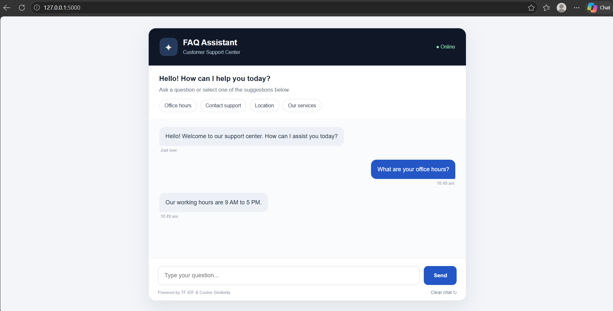

# FAQ Chatbot

An intelligent FAQ chatbot built using Python, Flask, TF-IDF and Cosine Similarity. It matches user questions with a predefined FAQ dataset and returns the most relevant answer.

## Features

- Automated FAQ question matching
- TF-IDF text vectorization
- Cosine Similarity-based matching
- Predefined FAQ dataset using CSV
- Fallback response for unknown questions
- Interactive web-based chat interface
- Suggested questions and message timestamps
- Responsive user interface

## Application Screenshot



## Technologies Used

- Python
- Flask
- Pandas
- Scikit-learn
- HTML
- CSS
- JavaScript

## Project Structure

```text
FAQ_Chatbot/
│
├── templates/
│   └── index.html
│
├── .gitignore
├── app.py
├── chatbot.py
├── faqs.csv
├── requirements.txt
├── screenshot.png
├── test_chatbot.py
└── README.md
```

## Installation

### 1. Clone the repository

```bash
git clone https://github.com/navyamvk2002-design/CodeAlpha_FAQ_Chatbot.git
```

### 2. Navigate to the project folder

```bash
cd CodeAlpha_FAQ_Chatbot
```

### 3. Create a virtual environment

```bash
python -m venv venv
```

### 4. Activate the environment

Windows PowerShell:

```powershell
.\venv\Scripts\Activate.ps1
```

### 5. Install dependencies

```bash
pip install -r requirements.txt
```

## Run the Application

```bash
python app.py
```

Open the following URL in your browser:

```text
http://127.0.0.1:5000
```

## How It Works

1. FAQ questions and answers are loaded from a CSV file.
2. TF-IDF converts the questions into numerical vectors.
3. The user's question is transformed using the same vectorizer.
4. Cosine Similarity calculates how closely the question matches the stored FAQs.
5. The chatbot returns the answer associated with the best match.
6. If the similarity score is below the threshold, a fallback response is returned.

## Future Improvements

- Expand the FAQ dataset.
- Add support for multiple languages.
- Improve text preprocessing.
- Integrate a database for dynamic FAQ management.

## Author

**Navya Prabhakaran**

AI Internship Project – CodeAlpha